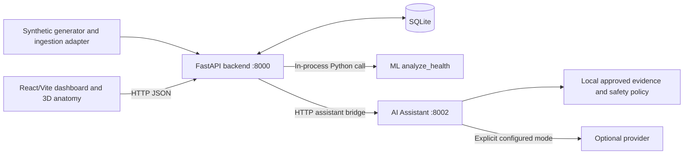

# Integrated prototype architecture

This describes the implementation at integration commit `37e2ddd`, with the
subsequent CORS/documentation correction pass. The central backend is the
browser's API boundary; modules retain separate ownership.

## Runtime boundaries

| Module | Implemented responsibility |
|---|---|
| Data engine | Reproducible synthetic records; adapter adds units and simulated provenance for ingestion |
| Backend, port 8000 | Profile CRUD, ingestion, latest/history, SQLite persistence, local ML and stored analyses, assistant bridge |
| ML engine | `aegis_ml.analyze_health`; personalized baselines, eligible Isolation Forest and descriptive trends; no separate server required |
| AI Assistant, port 8002 | Separate FastAPI service; input policy, local evidence and optional provider generation |
| Frontend | DEMO/LIVE API modes, metrics/charts, assistant chat and React Three Fiber anatomy |

Vite's port is not set in `frontend/vite.config.js`. Use its printed URL, or
explicitly select an available port and matching backend CORS origin. Integrated
examples select `localhost:5175`; previous QA used 5176 with an explicit
allowlist. Bind development services to loopback. This prototype has no
public-service authentication/authorization layer.

## Available APIs

The backend implements `/health`, `/astronauts` and astronaut CRUD,
`/health/ingest`, `/health/{astronaut_id}/latest` and
`/health/{astronaut_id}/history`, analysis
POST/list/latest/detail routes under `/health/{astronaut_id}/analyses`, and
`POST /ai/assistant`. See [API contracts](api-contracts.md) and the complete
[backend endpoint inventory](../backend/README.md#implemented-endpoint-inventory).
Runtime `/openapi.json` and `/docs` provide authoritative schemas.

The AI service exposes health, demo, chat, alert explanations, the
backend-compatible `/api/v1/assistant/respond`, knowledge and voice prototype
routes. Its [README](../ai-assistant/README.md#api-routes) lists them. The
dashboard calls only the backend, never Google or the AI service directly.

## Provenance and safety

DEMO MODE uses fabricated local readings and explicit synthetic markers. LIVE
API MODE retrieves stored synthetic data; it does not mean NASA telemetry.
Only explicit `skin_temperature_c` is mapped through ingestion to ML; the
legacy body-temperature field is not relabelled as skin temperature.

ML mock mode is a labelled placeholder; local ML executes the actual algorithm
on synthetic inputs. Missing/insufficient data remains unknown. Scores are
not medical probabilities, and global vital-sign/ML findings never become
localized anatomical highlights. Yellow/red regions require explicit
educational markers. Four anatomy layers retain 128 existing meshes, including
34 organ-group meshes rather than 34 distinct organs.

Backend assistant `mode: mock` never contacts the AI service. `mode: local`
means the configured HTTP bridge; it does not identify Gemini or prove real
generation. Controlled stubs can return structurally valid non-mock-labelled
fixtures. Real Gemini acceptance requires a separately approved, observed full
path. Health HTTP 200 is not generation evidence. Only the AI service holds
provider credentials; keep keys out of Vite and Git.

Nothing here is clinically validated or suitable for medical/mission decisions.
See the [data schema](data-schema.md), [anatomy limitations](anatomy-layer-improvements.md)
and [current QA/acceptance record](aegis-final-integration-qa.md).
